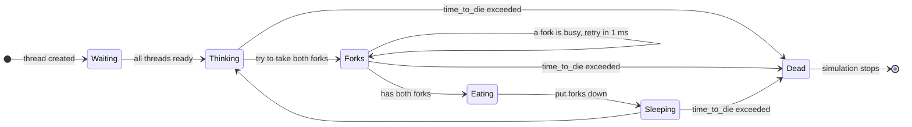

*This project has been created as part of the 42 curriculum by tfournie.*

<h1 align="center">🍝 Philosophers</h1>

<p align="center">
  <b>The dining philosophers problem, solved in C with POSIX threads and mutexes.</b><br>
  No deadlock, no data race, no starvation.
</p>

<p align="center">
  
  
  
</p>

---

## 📖 The problem

A number of philosophers sit around a round table with a bowl of spaghetti. There is **one fork between each pair of neighbours**, and a philosopher needs **both** the fork on their left and the fork on their right to eat.

Each philosopher loops forever: **eat → sleep → think**. If a philosopher goes longer than `time_to_die` milliseconds without starting a meal, they die and the simulation stops.

The hard part is not the rules, it is the concurrency. Every philosopher is a thread and every fork is a shared resource, so the program has to avoid:

- **Deadlock**: everyone holds one fork and waits forever for the other
- **Starvation**: some philosophers never get to eat
- **Data races**: two threads reading and writing the same data at the same time
- **Late death reports**: a death must be printed as soon as it happens, not seconds later

## 🧠 How it works



### 🔓 Non-blocking forks, so no deadlock
Each fork is a boolean protected by its own mutex. A philosopher **never waits on a mutex while holding a fork**: they lock the fork's mutex, check if it is free, take it if possible, and unlock right away. If the second fork is busy, they retry 1 ms later and keep checking whether they are still alive. Because nobody ever blocks while holding a resource, the classic circular wait cannot happen.

### ⏱️ Synchronized, then staggered start
- **Start barrier:** threads are created one by one, but none of them starts until **all** of them exist. If a `pthread_create` fails, the threads already created are told to stop and are joined, so nothing leaks.
- **Staggered start:** even-numbered philosophers wait `time_to_eat / 2` before their first meal. The odd ones take their forks first, which removes the "everyone grabs their left fork at the same time" scenario and spreads meals fairly.

### 💀 Death detection
- Each philosopher checks their own deadline (`last meal + time_to_die`) before every action and **during sleep**: the sleep is split into 5 ms slices, so a death is never hidden behind a long `usleep`.
- The first thread to detect a death sets a shared flag under a mutex. Every other thread sees it and stops, so **exactly one** `died` line is printed.

### 🛡️ Thread safety
| Shared data | Protected by |
|---|---|
| Each fork | its own mutex |
| The "someone died" flag | `mu_dead` |
| Log output (one line at a time, never interleaved) | `mu_time` |
| Count of philosophers who have eaten enough | `mu_eat` |
| Start barrier | `mu_init` |

### 🎯 Precise timing
`usleep` alone drifts. `ft_usleep` sleeps in 500 µs steps and re-reads the clock (`gettimeofday`) each time, so the timestamps in the logs stay accurate to the millisecond.

## 🚀 Usage

```bash
cd philo
make
./philo number_of_philosophers time_to_die time_to_eat time_to_sleep [number_of_times_each_philosopher_must_eat]
```

- All times are in milliseconds
- Up to 250 philosophers
- With the optional last argument, the simulation stops once every philosopher has eaten that many times
- Invalid input (missing arguments, negative numbers, letters…) prints the usage and exits

Each event is printed as `timestamp_in_ms philosopher_id action`:

```text
1 1 is thinking
1 2 is thinking
1 5 is thinking
1 3 is thinking
1 4 is thinking
2 1 has taken a fork
2 1 has taken a fork
2 1 is eating
...
```

## 🧪 Test cases

| Command | Expected result |
|---|---|
| `./philo 1 800 200 200` | Only one fork exists: the philosopher takes it and **dies at 800 ms** |
| `./philo 5 800 200 200` | Nobody dies, runs forever |
| `./philo 4 410 200 200` | Nobody dies, runs forever (tight timing) |
| `./philo 5 800 200 200 7` | Stops after every philosopher has eaten 7 times |
| `./philo 4 310 200 100` | A philosopher **dies at about 310 ms** |

Checked with Valgrind's thread error detector, which reports **0 errors**:

```bash
valgrind --tool=helgrind ./philo 5 800 200 200 2   # data races and lock order
# ERROR SUMMARY: 0 errors from 0 contexts
```

## 🗂️ Project structure

```text
philo/
├── include/
│   ├── philo.h            # t_data (shared state), t_philo (one per thread)
│   └── lib_utils.h
└── src/
    ├── main.c             # parse, init, wait for the end, clean up
    ├── main_utils/        # parsing, init of data / mutexes / threads, logs, cleanup
    ├── routine/           # thread routine: forks, eat, sleep, think, death checks
    └── lib_utils/         # atoi, number checks, millisecond clock and precise sleep
```

## 📚 Resources

- [Dining philosophers problem (Wikipedia)](https://en.wikipedia.org/wiki/Dining_philosophers_problem)
- [POSIX threads programming (LLNL)](https://hpc-tutorials.llnl.gov/posix/)
- `man pthread_create`, `man pthread_mutex_lock`, `man gettimeofday`
